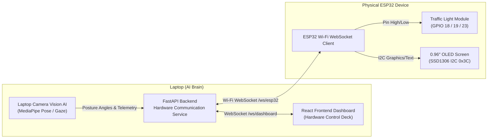

# AI StudySense - Physical Hardware Communication Protocol

## 1. System Overview & Architecture

The **AI StudySense Physical Device** consists of an **ESP32** microcontroller coupled with a **0.96-inch OLED display (SSD1306)** and a **3-color Traffic Light module (Red / Yellow / Green LEDs)**.

- **Laptop:** Serves as the high-compute **AI Brain** (local MediaPipe Pose posture tracking, gaze estimation, face auth, SM-2 scheduling, and AI coaching).
- **ESP32:** Acts as the dedicated **Wireless Hardware Controller**. It receives structured, low-bandwidth state updates over Wi-Fi WebSocket rather than raw image frames.
- **Frontend Dashboard:** Connects via WebSocket to receive real-time device telemetry (`ESP32 CONNECTED` / `ESP32 DISCONNECTED`, active LED pin, OLED preview, and latency).



---

## 2. Endpoints & Transport

### A. WebSocket Endpoints
- **ESP32 Controller Endpoint:** `ws://<backend_host>:8000/ws/esp32?device_id=esp32_studysense`
  - Transport: Bidirectional WebSocket over Wi-Fi (JSON text frames).
  - Handles Handshake, Heartbeat Ping/Pong, and State Updates.
- **Frontend Dashboard Endpoint:** `ws://<backend_host>:8000/ws/dashboard`
  - Broadcasts live device status, telemetry, and test results.

### B. REST Endpoints (Behind Backend Service)
| Method | Path | Description |
| :--- | :--- | :--- |
| `GET` | `/api/v1/hardware/status` | Live hardware status, connected devices, active LED, OLED state. |
| `POST` | `/api/v1/hardware/command` | Manually/programmatically dispatch state update. |
| `POST` | `/api/v1/hardware/test-mode` | Hardware Test Mode: test GREEN, YELLOW, RED, and OLED expressions. |
| `POST` | `/api/v1/hardware/ping` | Ping connected ESP32 devices to measure link liveness. |
| `GET` | `/api/v1/hardware/protocol` | Formal JSON protocol specification. |

---

## 3. Protocol State Definitions & Priority Rules

### State Enumeration
1. **`POSTURE_GOOD`** (Traffic Light: **GREEN**, OLED: `^_^` `FLOW STATE`)
2. **`POSTURE_BUFFER`** (Traffic Light: **YELLOW**, OLED: `-_-` `SIT STRAIGHT`)
3. **`POSTURE_BAD`** (Traffic Light: **RED**, OLED: `>_<` `POSTURE ALERT`)
4. **`FOCUS_GOOD`** (Screen presence optimal)
5. **`FOCUS_WARNING`** (Eyes away from screen / distracted, OLED: `O.O` `EYES ON STUDY`)
6. **`BREAK`** (Pomodoro / 52-17 break active, OLED: `Zzz` `REST BREAK`)
7. **`SESSION_ACTIVE`** (Live study timer running)
8. **`SESSION_COMPLETE`** (Session concluded, OLED: `★_★` `SESSION DONE`)
9. **`ESP32_CONNECTED`** (Hardware handshake established)
10. **`ESP32_DISCONNECTED`** (Hardware socket closed or heartbeat timed out)
11. **`ERROR`** (Hardware or communication exception)

### Priority Resolution Rule
> **Posture has strict highest priority for the traffic-light module:**
> - `POSTURE_BAD` $\rightarrow$ **RED LED** (Overrides all other states)
> - `POSTURE_BUFFER` $\rightarrow$ **YELLOW LED** (Warning threshold)
> - `POSTURE_GOOD` $\rightarrow$ **GREEN LED** (Allows secondary focus/session states on OLED)

---

## 4. Message Schemas

### 1. ESP32 Identification Handshake (Device $\rightarrow$ Laptop)
Sent by the ESP32 immediately upon establishing the WebSocket connection:
```json
{
  "type": "HANDSHAKE",
  "device_id": "esp32_studysense_01",
  "firmware_version": "1.0.0",
  "chip_model": "ESP32-WROOM-32",
  "mac_address": "24:6F:28:AB:CD:EF",
  "capabilities": ["traffic_light", "oled_ssd1306"]
}
```

**Laptop Handshake Acknowledgement (Laptop $\rightarrow$ Device):**
```json
{
  "type": "HANDSHAKE_ACK",
  "status": "authenticated",
  "server_time": "2026-10-09T01:30:00Z",
  "heartbeat_interval_sec": 5
}
```

### 2. Periodic Heartbeat (Device $\rightarrow$ Laptop)
Sent every 5 seconds by the ESP32 to maintain connection health:
```json
{
  "type": "HEARTBEAT",
  "device_id": "esp32_studysense_01",
  "uptime_ms": 348210,
  "rssi": -54,
  "free_heap": 218400
}
```
**Laptop Response (Laptop $\rightarrow$ Device):**
```json
{
  "type": "PONG",
  "device_id": "esp32_studysense_01",
  "server_time": "2026-10-09T01:30:05Z"
}
```

### 3. Structured State Update (Laptop $\rightarrow$ Device)
Transmitted whenever posture, focus, or session timer state updates:
```json
{
  "type": "STATE_UPDATE",
  "seq": 104,
  "timestamp": "2026-10-09T01:30:10Z",
  "led": "GREEN",
  "oled": {
    "animation": "good_posture",
    "title": "FLOW STATE",
    "subtitle": "Ergonomics Good",
    "expression": "^_^",
    "timer_seconds": 1440,
    "timer_formatted": "24:00"
  },
  "posture_status": "POSTURE_GOOD",
  "focus_status": "FOCUS_GOOD",
  "session_status": "SESSION_ACTIVE",
  "session_id": 4,
  "message": "FLOW STATE"
}
```

### 4. Hardware Test Command (Laptop $\rightarrow$ Device)
Used by the Dashboard Hardware Test Deck:
```json
{
  "type": "STATE_UPDATE",
  "seq": 105,
  "timestamp": "2026-10-09T01:30:15Z",
  "led": "YELLOW",
  "oled": {
    "animation": "buffer_warning",
    "title": "SIT STRAIGHT",
    "subtitle": "Buffer Warning",
    "expression": "-_-"
  },
  "posture_status": "POSTURE_BUFFER",
  "focus_status": "FOCUS_GOOD",
  "session_status": "SESSION_ACTIVE",
  "message": "TEST: YELLOW"
}
```

---

## 5. Heartbeat & Watchdog Timeout Specification

- **ESP32 Heartbeat Interval:** 5 seconds.
- **Backend Watchdog Timeout:** 15 seconds.
- If no heartbeat or frame is received from a connected device within 15 seconds, the backend automatically transitions the device state to `ESP32_DISCONNECTED` and broadcasts the update to the frontend dashboard.
- Upon reconnection, the ESP32 performs the `HANDSHAKE` sequence and instantly receives the current synchronized state.
