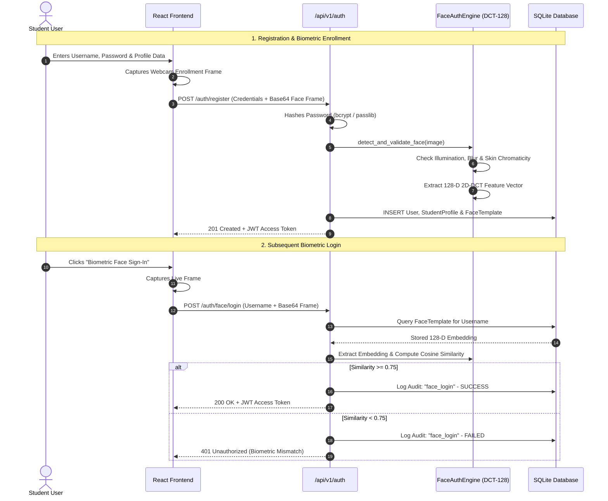
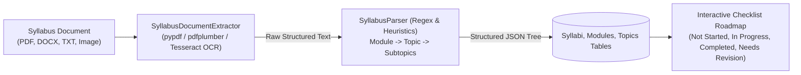
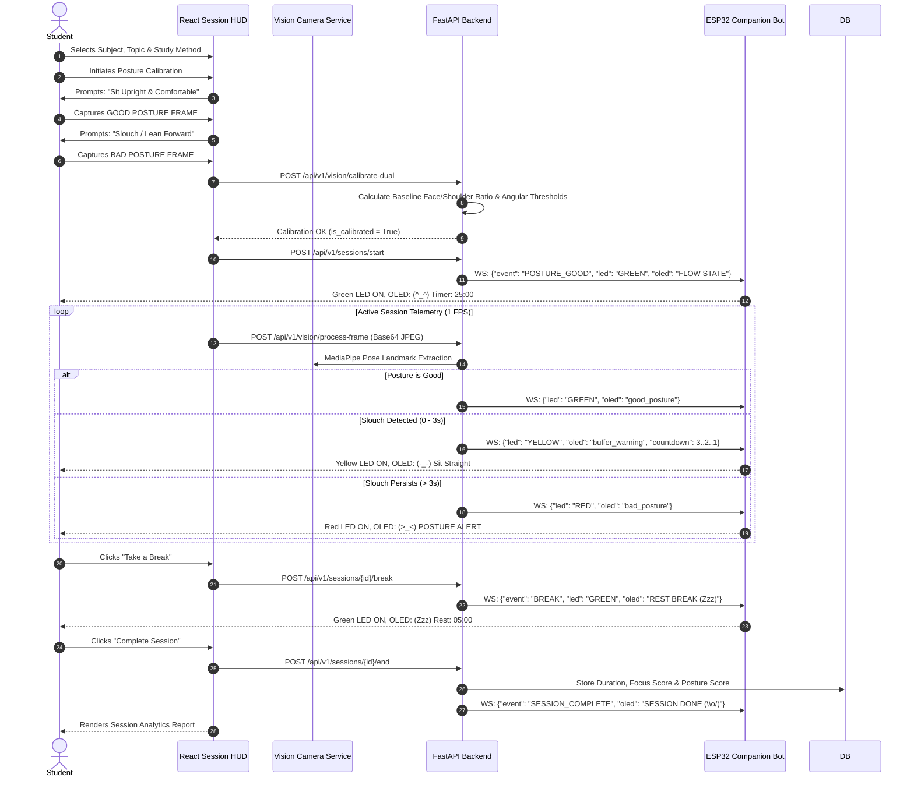
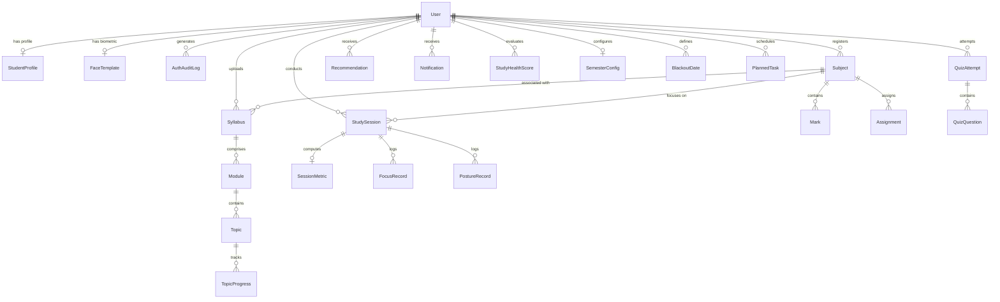

# AI StudySense — Comprehensive Project Documentation

---

## 1. Executive Summary and Project Identification

### Project Identification
- **Project Title:** AI StudySense — Intelligent Academic Companion & Ergonomic Focus Ecosystem
- **Project Category:** Applied Artificial Intelligence, Edge Computer Vision, Educational Technology (EdTech), Internet of Things (IoT), and Embedded Systems.
- **Project Repository:** `Study_helper` (Full-Stack Academic Platform)
- **Target Operating System:** Windows / Linux / macOS (Laptop Client & Server); FreeRTOS / Espressif ESP-IDF (ESP32 Firmware)

### Project Concept & Purpose
**AI StudySense** is a cyber-physical academic study companion engineered to bridge the gap between long-term semester curriculum planning and the real-time physical realities of daily study sessions. Traditional academic workflows force students to scatter their efforts across fragmented, disconnected utilities: digital calendars for assignment deadlines, standalone Pomodoro apps for focus timing, generic PDF readers for course syllabuses, and manual habit trackers. Furthermore, these software-only solutions remain completely oblivious to the student's physical study environment, leading to chronic posture slouching, eye strain, ergonomic fatigue, unchecked smartphone distractions, and undetected desk departures.

AI StudySense addresses these challenges by consolidating:
1. **Automated Curriculum Ingestion & Semester Planning:** Document parsing (PDF, DOCX, OCR) that extracts course syllabuses into hierarchical modules, topics, and subtopics, automatically distributing them across semester calendar dates while respecting assignment due dates and academic blackout days.
2. **Cognitive Study Method Execution:** Native software orchestration of five proven pedagogical study frameworks (Pomodoro Technique, 52/17 Deep Work, Active Recall, SuperMemo-2 Spaced Repetition, and the Feynman Technique).
3. **Local Edge Computer Vision:** Private on-device laptop webcam analysis using Google MediaPipe Pose Landmarker to evaluate ergonomics, detect posture slouching with a forgiving 3-second buffer window, audit smartphone usage, and timestamp desk absences.
4. **Wireless Physical IoT Desk Companion:** A dedicated ESP32 microcontroller driving an expressive 0.96″ SSD1306 I2C OLED display and an ambient 3-pin Traffic Light module (Green, Yellow, Red) positioned in the student's peripheral field of view, delivering real-time status feedback without screen pop-ups or monitor clutter.
5. **Session Analytics & Academic Growth:** Comprehensive post-session reporting synthesizing ergonomic health metrics, focus percentages, cognitive quiz scores, and rule-based diagnostic recommendations.

### Project Objectives
- **Centralize Academic Management:** Provide a unified repository for course subjects, weighted marks (CATs, Quizzes, Labs, End Semester Exams), and assignment submission deadlines.
- **Automate Syllabus Extraction:** Convert unstructured syllabus files into interactive progress checklists with prerequisite dependency tracking.
- **Implement Privacy-Preserving Computer Vision:** Execute all camera frame processing locally on the client machine; no raw webcam imagery or video streams are ever stored on disk or transmitted over external networks.
- **Eliminate Posture False Positives via Dual-Point Calibration:** Calibrate ergonomic detection against individual user physique, chair height, and camera angle by capturing both an upright reference and a slouched reference prior to session initiation.
- **Provide Ambient Peripheral Feedback:** Offload cognitive monitoring to a standalone physical desk bot, reducing screen-switching distractions.

---

## 2. Problem Statement and Motivation

Modern university and high-school students encounter severe cognitive and physiological friction throughout their academic journeys:

1. **Syllabus Disorganization & Fragmented Curricula:** Course syllabuses are distributed as static PDF documents or scanned images. Students struggle to break dense course outlines into manageable daily study goals, resulting in last-minute cramming and skipped foundational topics.
2. **Poor Study Consistency & Erroneous Pacing:** Without an adaptive schedule that accounts for holidays, examination weeks, and assignment deadlines, students fail to maintain steady study habits across a 15-week semester.
3. **Ergonomic Deterioration & "Tech-Neck" Syndrome:** Prolonged study sessions in front of laptops inevitably lead to cervical spine flexion, forward head posture, and slumped shoulders. Over time, poor posture causes tension headaches, musculoskeletal pain, and chronic fatigue.
4. **Digital Distractions & Smartphone Intrusion:** The proximity of smartphones creates habitual task-switching. Standard mobile blocking apps fail because the device remains physically accessible on the desk.
5. **Alert Fatigue from Invasive Software Notifications:** On-screen pop-ups and auditory alarms break deep work flow states, annoying the user and prompting them to disable monitoring tools altogether.
6. **Lack of Objective Session Analytics:** Students cannot accurately quantify how much time they actually spent in deep focus versus micro-distractions or physical slouching.

### Comparative Problem-Solution Matrix

| Existing Student Problem | AI StudySense Architectural Solution | Measured / Expected Benefit |
| :--- | :--- | :--- |
| **Scattered course outlines & static PDFs** | Automated syllabus parser extracting hierarchical modules, topics, and subtopics into interactive checklists. | Reduces subject onboarding time from hours to seconds; provides clear visual roadmap. |
| **Unrealistic study timetables** | Academic Planner Engine distributing topics across actual semester dates, accounting for blackout dates and assignment deadlines. | Prevents academic debt; balances daily cognitive workload across the term. |
| **Prolonged posture slouching & spinal strain** | Dual-calibrated MediaPipe Pose tracking calculating real-time ear-to-shoulder displacement and vertical tilt. | Early ergonomic intervention; reinforces healthy spinal alignment habits. |
| **Nuisance alarms during natural movements** | 3-second forgiving buffer window with Yellow warning before confirming a Red posture alert. | Eliminates false alarms caused by natural shifts, taking quick notes, or adjusting chairs. |
| **Phone distractions during study hours** | Pose-based wrist elevation heuristic flagging smartphone usage within the camera's field of view. | Objective accountability; discourages reflexive device pickup during focus sprints. |
| **Desk abandonment & untracked breaks** | Continuous presence verification logging timestamped absence intervals and durations. | Accurate net study time calculation; identifies restlessness and study breaks. |
| **Context switching from screen pop-ups** | Ambient wireless companion bot (Traffic Light LEDs + 0.96″ OLED display) providing non-intrusive feedback. | Keeps the student in deep flow without cluttering laptop monitors with status widgets. |
| **Superficial completion metrics** | Composite Session Analytics combining Focus Score, Posture Score, Productivity Score, and SM-2 Spaced Repetition data. | Actionable reflection; highlights weak topics and ergonomic trends over time. |

---

## 3. Complete System Architecture and Data Flow

AI StudySense is architectured as a multi-tier cyber-physical distributed system comprising the **Frontend Presentation Layer**, **FastAPI Backend Application Layer**, **Relational Persistence Layer**, **Edge Computer Vision Pipeline**, and **Wireless Embedded IoT Hardware**.

```mermaid
flowchart TD
    subgraph ClientWorkstation["Student Workstation (Laptop / Desktop)"]
        Webcam["Laptop Integrated / USB Webcam"]
        UI["React 18 / Vite Web Application\n(http://localhost:5173)"]
        Canvas["HTML5 Canvas / MediaDevices HUD"]
    end

    subgraph BackendServer["FastAPI Backend Application (Port 8000)"]
        Router["FastAPI API Router (/api/v1)"]
        VisionService["LaptopCameraAIService\n(OpenCV + MediaPipe Pose)"]
        PostureEngine["PostureAnalyzer\n(Dual Calibration + Buffer Engine)"]
        PlannerService["AcademicPlannerEngine\n(Curriculum Scheduling)"]
        SM2Service["SM2Scheduler\n(Spaced Repetition Algorithm)"]
        CoachService["AICoach & WeaknessDetector\n(Pedagogical Rule Engines)"]
        HwService["HardwareCommunicationService\n(WebSocket Manager & Watchdog)"]
    end

    subgraph DatabaseLayer["Persistence Layer"]
        DB[(SQLite Embedded DB\nstudysense.db via SQLAlchemy)]
    end

    subgraph HardwareBot["Wireless Desk Companion (IoT Edge)"]
        ESP32["ESP32 Microcontroller (38-Pin)\nWi-Fi Station + WebSocketsClient"]
        OLED["0.96\" SSD1306 I2C OLED\n(128x64 Animation Engine)"]
        TrafficLight["Traffic Light LED Module\n(Green: 25, Yellow: 26, Red: 27)"]
    end

    Webcam -->|Raw Video Frames| Canvas
    Canvas -->|1 FPS Base64 JPEG Telemetry\nPOST /api/v1/vision/process-frame| Router
    UI <-->|REST API Requests & JWT Auth| Router
    UI <-->|Live Telemetry & Dashboard Sync\nws://localhost:8000/ws/dashboard| Router

    Router --> VisionService
    VisionService --> PostureEngine
    Router --> PlannerService
    Router --> SM2Service
    Router --> CoachService
    Router --> HwService

    Router <-->|Async ORM Operations| DB

    HwService <-->|Bidirectional JSON WebSocket\nws://10.162.167.218:8000/ws/device| ESP32
    ESP32 -->|I2C Bus (SDA:21, SCL:22)| OLED
    ESP32 -->|GPIO Digital Writes| TrafficLight
```

### Detailed Component Roles & Interaction Dynamics

1. **Frontend Web Application (React/Vite):**
   - Renders the responsive user interface, including the Academic Command Center, Semester Planner, Subject Manager, Syllabus Roadmaps, Study Session Runner, and Post-Session Reports.
   - Manages client-side audio timers, camera permissions via `navigator.mediaDevices.getUserMedia`, and frame downsampling using an offscreen HTML5 `<canvas>`.
   - Maintains two network channels: asynchronous HTTP (via Axios with an automatic token refresh interceptor) and real-time WebSockets for receiving live telemetry broadcasts.

2. **Backend Application Layer (FastAPI / Uvicorn):**
   - Coordinates all business logic, user authentication, database CRUD operations, and computational planning algorithms.
   - Binds to `0.0.0.0:8000` to allow simultaneous local browser connections (`localhost:5173`) and local area network (LAN) connections from external microcontrollers over Wi-Fi.
   - Manages WebSocket route aliases (`/ws/device` and `/ws/esp32` for hardware; `/ws/dashboard`, `/ws/session`, and `/ws/study` for frontend clients).

3. **Database Layer (SQLAlchemy ORM & SQLite):**
   - Employs an embedded SQLite database (`studysense.db`) accessed via asynchronous SQLAlchemy connections (`aiosqlite`).
   - Automatically synchronizes schema definitions and applies zero-downtime column migrations on startup via an SQLite `PRAGMA table_info` dynamic inspector.

4. **Edge Computer Vision & Posture Engine:**
   - Ingests base64-encoded JPEG frames transmitted at approximately 1 frame per second (FPS) from the frontend during active study sessions.
   - Executes local landmark extraction using the official MediaPipe Pose Landmarker task model (`models/pose_landmarker_full.task`).
   - Computes neck inclination angles, shoulder slant, and scale/zoom changes relative to calibrated user reference baselines.

5. **Hardware Communication Service & State Priority Resolver:**
   - Resolves multi-modal events into deterministic hardware outputs. When competing events occur (e.g., student is slouched while a timer is ticking), the resolver applies strict priority hierarchy:
     $$\text{Desk Absence (RED)} > \text{Phone Distraction (RED)} > \text{Confirmed Bad Posture (RED)} > \text{Buffer Warning (YELLOW)} > \text{Active Flow (GREEN)}$$
   - Dispatches structured JSON state packets (`STATE_UPDATE`) and monitors device connectivity using an automated 15-second heartbeat watchdog.

6. **Wireless IoT Desk Bot (ESP32 Companion):**
   - Operates in Wi-Fi Station mode on a 2.4 GHz local network, connecting to the laptop backend via WebSocket.
   - Drives a 0.96″ monochrome SSD1306 OLED display using a non-blocking 12 FPS animation engine that renders expressive facial expressions (`^_^`, `O_O`, `>_<`, `X_X`, `?_?`, `Zzz`, `\o/`) and countdown timers.
   - Controls a 3-pin Traffic Light module via direct digital GPIO switching.

---

## 4. Technology Stack and Rationale

```
+-------------------------------------------------------------------------------------------------------+
|                                    AI STUDYSENSE TECHNOLOGY MATRIX                                    |
+---------------------+-------------------------------+-------------------------------------------------+
| Component           | Technologies & Libraries      | Architectural Purpose                           |
+---------------------+-------------------------------+-------------------------------------------------+
| Frontend UI         | React 18, Vite 8, Tailwind    | High-performance Single Page Application (SPA), |
|                     | CSS, Lucide React, Axios      | rapid build pipeline, responsive design system. |
+---------------------+-------------------------------+-------------------------------------------------+
| Backend Gateway     | Python 3.13, FastAPI,         | Asynchronous ASGI REST & WebSocket gateway,    |
|                     | Uvicorn, Pydantic v2          | strict schema validation, background tasks.     |
+---------------------+-------------------------------+-------------------------------------------------+
| Data Persistence    | SQLAlchemy ORM, aiosqlite,    | Asynchronous ORM, relation modeling, automatic |
|                     | SQLite3                       | table migration, lightweight embedded storage.  |
+---------------------+-------------------------------+-------------------------------------------------+
| Computer Vision     | OpenCV (cv2), Google          | 33-point 3D skeletal tracking, YCrCb skin seg-  |
|                     | MediaPipe Pose Landmarker     | mentation, DCT-128 facial verification.         |
+---------------------+-------------------------------+-------------------------------------------------+
| Document AI         | PyPDF (pypdf), pdfplumber,    | Syllabus document digitization, module/topic    |
|                     | python-docx, Tesseract OCR    | hierarchical extraction, regex tokenizer.       |
+---------------------+-------------------------------+-------------------------------------------------+
| Pedagogical AI      | SM-2 Spaced Repetition,       | Memory consolidation modeling, Bloom-based      |
|                     | Rule-based Diagnostic Engines | quiz evaluation, balanced semester scheduling.  |
+---------------------+-------------------------------+-------------------------------------------------+
| Embedded Hardware   | ESP32 (38-Pin), Arduino C++,  | Ambient peripheral IoT feedback, 12 FPS non-    |
|                     | Adafruit SSD1306 / GFX        | blocking OLED expressions, GPIO LED control.    |
+---------------------+-------------------------------+-------------------------------------------------+
```

### Detailed Justification of Selected Technologies

#### 1. Frontend Framework: React 18 with Vite
- **Rationale:** React's component-based virtual DOM architecture allows modular state separation between the live camera HUD, study session timers, syllabus accordions, and real-time hardware status indicators. Vite was selected over Create React App (CRA) due to its native ES-module hot module replacement (HMR), sub-second build times, and zero-configuration asset bundling.
- **Alternatives Considered:** Vanilla JavaScript (lacks scalable state management for complex reactive dashboards); Next.js (unnecessary server-side rendering overhead for a localized desktop application).

#### 2. Backend Framework: FastAPI with Uvicorn
- **Rationale:** Built on Starlette and Pydantic, FastAPI delivers high asynchronous throughput using Python `async`/`await` routines. It natively supports concurrent HTTP REST operations and persistent bidirectional WebSockets within the same event loop, eliminating the need for a secondary WebSocket broker (such as Socket.IO or Redis). Automatic OpenAPI documentation (`/docs`) ensures seamless frontend-backend API synchronization.
- **Alternatives Considered:** Flask (synchronous by default, requiring complex threading for concurrent WebSockets); Django (heavyweight monolithic architecture with excessive overhead for lightweight microservices).

#### 3. Database Layer: SQLite with SQLAlchemy Async ORM
- **Rationale:** AI StudySense is engineered for personal workstation deployment. SQLite is serverless, zero-configuration, and fully self-contained in a single local database file (`studysense.db`), eliminating external service dependencies (like PostgreSQL or MySQL). SQLAlchemy's asynchronous extension (`aiosqlite`) ensures that heavy database reads/writes during session logging never block the FastAPI main event loop.
- **Alternatives Considered:** PostgreSQL (excellent for multi-tenant enterprise deployments, but introduces burdensome installation hurdles for single-student desktop setups).

#### 4. Computer Vision: Google MediaPipe Pose Landmarker & OpenCV
- **Rationale:** MediaPipe provides optimized, lightweight machine learning inference for 33 full-body 3D landmarks that run at high frame rates on standard laptop CPUs without requiring dedicated CUDA GPUs. OpenCV handles frame resizing, color-space transformations (BGR to RGB/YCrCb), and image decoding.
- **Alternatives Considered:** OpenPose (requires heavy enterprise GPUs and complex C++ builds); YOLOv8-Pose (higher computational overhead for a study companion intended to run quietly in the background).

#### 5. Embedded Hardware: ESP32 38-Pin Dual-Core MCU
- **Rationale:** The ESP32 provides native 2.4 GHz 802.11 b/g/n Wi-Fi, hardware I2C support, multiple digital GPIO outputs, and 520 KB SRAM. Its dual-core Tensilica Xtensa processor enables one core to handle background network protocol stacks while the other executes non-blocking OLED rendering and GPIO manipulation.
- **Alternatives Considered:** ESP8266 (single core, limited memory, prone to watchdog resets during intensive animation); Raspberry Pi (excessive cost and power consumption for a simple peripheral display device).

---

## 5. Architectural Lineage: Role of the `AI_Study_Bot` Directory

The workspace contains an auxiliary directory titled `AI_Study_Bot`. An inspection of this directory reveals its role as the **experimental research prototype and algorithm testbed** that preceded the full-stack AI StudySense platform:

1. **Evolutionary Lineage:**
   - `AI_Study_Bot/camera_test.py`: Validated raw OpenCV webcam capture and system camera indices.
   - `AI_Study_Bot/pose_test.py` & `pose_test_new.py`: Experimented with early MediaPipe Pose Tasks API configurations.
   - `AI_Study_Bot/pose_webcam.py`: Prototyped live skeleton drawing on desktop OpenCV windows (`cv2.imshow`).
   - `AI_Study_Bot/posture_angle.py`: The core standalone research script (2,439 lines of code). It pioneered the original ear-shoulder-vertical angle calculations, dual-frame calibration ratio, rolling window smoothing (`SMOOTHING_FRAMES = 10`), 3-second buffer threshold (`POOR_POSTURE_TIME = 3.0`), and direct HTTP polling to an ESP32 web server (`http://<ESP32_IP>/...`).

2. **Transition to AI StudySense Full-Stack Architecture:**
   While `AI_Study_Bot` functioned as a monolithic desktop script with hardcoded IP addresses, blocking `cv2.imshow()` loops, and HTTP polling, **AI StudySense** extracted and modernized these mathematical algorithms into production services:
   - The posture angle and scale logic was refactored into the object-oriented `ai/vision/posture_analyzer.py` module.
   - MediaPipe model execution was encapsulated in `ai/vision/camera_service.py`.
   - Fragile HTTP polling was replaced by an event-driven, bidirectional WebSocket protocol (`/ws/device`) in `backend/app/services/hardware_service.py`.
   - Desktop OpenCV windows were replaced by a modern React/Vite HUD (`LaptopCameraHUD.jsx`).

---

## 6. Authentication, Security, and Biometric Profile Management

AI StudySense provides dual authentication modalities: standard cryptographic password verification and local illumination-invariant facial verification.



### 1. Password Cryptography
- Passwords are encrypted using the `bcrypt` adaptive hashing algorithm via Passlib. Plaintext passwords are never logged, cached, or stored.
- Authentication tokens use industry-standard JSON Web Tokens (JWT) signed with HMAC-SHA256 (`HS256`).
- **Token Longevity & Refresh Interceptor:** To prevent students from being abruptly logged out during multi-hour study sessions, `ACCESS_TOKEN_EXPIRE_MINUTES` is set to 43,200 minutes (30 days). Furthermore, [`frontend/src/api/client.js`](file:///c:/Users/palur/OneDrive/Desktop/Study_helper/frontend/src/api/client.js) incorporates an automatic Axios response interceptor that captures HTTP 401 responses, calls `POST /api/v1/auth/refresh`, updates the local token, and transparently replays the failed request.

### 2. Local Biometric Face Authentication Engine (`ai/vision/face_auth.py`)
Rather than relying on unvetted cloud facial recognition APIs or heavyweight deep neural nets that require gigabytes of weights, AI StudySense implements a deterministic, illumination-invariant facial verification engine:
1. **Frame Quality Validation:**
   - Evaluates mean grayscale brightness ($25.0 \le \mu_{\text{gray}} \le 245.0$) to reject underexposed or overexposed frames.
   - Measures blur via the **Variance of the Laplacian**:
     $$\text{Var}(\nabla^2 I) = \frac{1}{N}\sum (L(x,y) - \bar{L})^2$$
     Frames with $\text{Var} < 5.0$ are rejected as blurry.
2. **Skin Chromaticity & Candidate Localization:**
   - Converts the frame to the $YCrCb$ color space and applies a skin threshold mask: $Cr \in [133, 173]$ and $Cb \in [77, 127]$.
   - Applies morphological opening and closing with an elliptical structuring element ($5 \times 5$) to eliminate noise and isolate the primary facial bounding box.
   - Enforces a single-person constraint; if multiple large faces ($> 12\%$ frame area) appear, authentication aborts.
3. **Multi-Block 2D Discrete Cosine Transform (DCT) Embedding:**
   - The detected face region is cropped and normalized to a canonical $96 \times 96$ resolution.
   - Contrast Limited Adaptive Histogram Equalization (CLAHE) is applied to neutralize uneven ambient lighting.
   - The normalized face is partitioned into a $4 \times 4$ grid of 16 spatial sub-blocks ($24 \times 24$ pixels each).
   - For each block, the 2D-DCT is calculated, and the top 8 low-to-mid frequency AC coefficients along the standard zig-zag path are extracted:
     $$\text{Total Dimensions} = 16 \text{ blocks} \times 8 \text{ coefficients} = 128 \text{ dimensions}$$
   - The resulting 128-dimensional vector is $L_2$-normalized: $\vec{v}_{\text{norm}} = \vec{v} / \|\vec{v}\|_2$.
4. **Cosine Similarity Verification:**
   - Matching between live embedding $\vec{u}$ and stored template $\vec{v}$ is evaluated via dot product:
     $$\text{Cosine Similarity} = \vec{u} \cdot \vec{v} = \sum_{i=1}^{128} u_i v_i$$
   - A calibrated threshold of $0.75$ serves as the boundary for positive verification. Every authentication attempt is permanently logged in the `auth_audit_logs` table.

---

## 7. Academic Management Module

The academic management subsystem stores, tracks, and analyzes course performance data, feeding quantitative signals directly into the AI Study Coach.

### 1. Subject Management (`subjects` table)
- Records academic courses with name, alphanumeric course code (e.g., `CS301`), semester designation, credit weighting (1.0 to 5.0), custom pastel theme color for calendar visualization, and student target score (e.g., $85\%$).
- Serves as the parent foreign-key anchor for marks, assignments, syllabuses, and study sessions.

### 2. Weighted Marks Tracker (`marks` table)
- Records individual assessment events categorized by assessment type:
  - Continuous Assessment Tests (CAT 1, CAT 2)
  - Quizzes and In-Class Tests
  - Laboratory Practicals
  - Midterm Examinations
  - End-Semester Final Examinations
- Each entry tracks `scored_marks`, `total_marks`, and an optional `weightage_percent` (e.g., CAT 1 accounts for $15\%$ of final grade).
- Automatically computes current weighted subject averages and flags underperforming courses (average $< 60\%$) to the diagnostic engine.

### 3. Assignment & Deadline Management (`assignments` table)
- Manages deliverables with title, description, submission deadline (`due_date`), estimated effort hours, priority level (`Low`, `Medium`, `High`, `Critical`), completion percentage ($0-100\%$), and status (`Not Started`, `In Progress`, `Completed`, `Overdue`).
- Directly integrates with the Academic Planner to insert study blocks before major deadlines.

---

## 8. Syllabus Intelligence and Interactive Checklist Roadmap

Rather than presenting syllabus tracking as a rigid, anxiety-inducing timetable, AI StudySense utilizes a **modular checklist roadmap** that adapts to student learning velocity.



### 1. Multi-Format Ingestion Pipeline (`ai/academic/syllabus_parser.py`)
- **Supported Formats:** PDF (`.pdf`), Microsoft Word (`.docx`), Plain Text (`.txt`, `.md`), and Image formats (`.png`, `.jpg`, `.jpeg`, `.webp`, `.tiff`).
- **File Validation:** Enforces a maximum file size limit of 15 MB.
- **Extraction Techniques:**
  - Standard PDFs are parsed using `pypdf`.
  - Scanned image-only PDFs fall back to embedded image extraction and OCR processing.
  - Microsoft Word files are parsed via `python-docx`, traversing document paragraphs and tabular grid structures.
  - Raw images are processed through Tesseract OCR (`pytesseract.image_to_string`).

### 2. Structural Parsing & Hierarchy Discovery
The parser executes heuristic pattern recognition to decompose raw text into a 3-level tree:
1. **Modules / Units:** Identified via regex patterns:
   ```regex
   ^(?:MODULE|UNIT|CHAPTER|PART|WEEK|SECTION)\s*[:\-\u2013]?\s*([0-9]+|[IVXLCDM]+)?\s*[:\-\u2013]?\s*(.*)$
   ```
2. **Topics & Subtopics:** Paragraphs within modules are split on bullet points, numbered delimiters, or semicolons. Comma-separated strings are classified as subtopics.
3. **Core Flagging & Prerequisite Chains:** Topics containing foundational keywords (*"algorithm"*, *"architecture"*, *"theorem"*, *"principle"*, *"structure"*) are automatically flagged with `is_core = True` and assigned prerequisite conceptual dependencies.

### 3. Checklist Interaction & State Transitions (`topic_progress` table)
Each topic exposes four functional states:
- **`Not Started`:** Default state upon registration.
- **`In Progress`:** Topic has been selected in an active study session or partially reviewed.
- **`Completed`:** Student has completed study objectives (increments module completion percentage).
- **`Needs Revision`:** Marked manually by the student or triggered automatically by low quiz performance ($< 60\%$) or spaced repetition decay.

---

## 9. Pedagogical Study Frameworks and Session Lifecycle

AI StudySense provides structured runtime orchestration for five scientifically validated study frameworks, as well as a flexible custom mode:

1. **Pomodoro Technique:**
   - **Protocol:** 25 minutes of deep focus followed by a 5-minute restorative micro-break. After 4 successive cycles, a 15-minute long break is triggered.
   - **Purpose:** Counteracts procrastination and prevents cognitive fatigue through frequent structured rest.
2. **52 / 17 Deep Work:**
   - **Protocol:** 52 minutes of uninterrupted flow followed by 17 minutes of complete cognitive disengagement.
   - **Purpose:** Optimized for ultradian biological rhythms during complex engineering tasks, software programming, and mathematical derivations.
3. **Active Recall:**
   - **Protocol:** 30-minute self-testing sessions where notes are hidden, requiring the student to actively reconstruct answers from memory.
   - **Purpose:** Strengthens neural retrieval pathways, resulting in significantly higher long-term retention compared to passive re-reading.
4. **SuperMemo-2 (SM-2) Spaced Repetition:**
   - **Protocol:** 20-minute targeted review intervals scheduled according to memory decay curves.
   - **Formula Implementation:**
     $$\text{EF}' = \max\left(1.3, \text{EF} + \left(0.1 - (5 - q) \times (0.08 + (5 - q) \times 0.02)\right)\right)$$
     $$\text{Interval}(n) = \begin{cases} 1 \text{ day}, & n = 1 \\ 6 \text{ days}, & n = 2 \\ \text{Round}(\text{Interval}(n-1) \times \text{EF}), & n > 2 \end{cases}$$
     Where $q \in [0, 5]$ represents recall quality. Failed reviews ($q < 3$) reset the repetition cycle to Day 1.
5. **Feynman Technique:**
   - **Protocol:** 35-minute sessions divided into 4 sequential stages: (1) Select concept, (2) Explain to a layperson without technical jargon, (3) Identify knowledge gaps, and (4) Formulate simple real-world analogies.
6. **Custom Session:**
   - Allows students to configure custom work durations, break intervals, and study goals.

### Complete Live Study Session Workflow



---

## 10. Computer Vision Posture Estimation and Calibration Engine

### 1. Camera Capture Pipeline
- Laptop webcam frames are accessed in the browser using the Web MediaDevices API:
  ```javascript
  navigator.mediaDevices.getUserMedia({ video: { width: 640, height: 480, facingMode: "user" } })
  ```
- **Full Field of View (FOV):** Video frames are rendered into a responsive HTML5 `<video>` element with `object-fit: contain` to preserve the complete wide-angle field of view. The interface avoids cropping or digital zooming so that both shoulders, the upper chest, and desk space remain clearly visible.
- Every 1,000 milliseconds, the frontend draws the current frame to a hidden `<canvas>`, compresses it to an optimized base64 JPEG data URL (`image/jpeg`, quality $0.65$), and transmits it via `POST /api/v1/vision/process-frame`.

### 2. MediaPipe Landmark Extraction (`ai/vision/camera_service.py`)
Frames are ingested into Google MediaPipe Pose Landmarker (`RunningMode.IMAGE`), extracting 33 normalized 3D landmarks $(x, y, z, \text{visibility})$. The posture engine specifically tracks:
- Nose ($0$)
- Left Ear ($7$) and Right Ear ($8$)
- Left Shoulder ($11$) and Right Shoulder ($12$)
- Left Wrist ($15$) and Right Wrist ($16$)

### 3. Dual-Point Reference Calibration
A core innovation of AI StudySense is its **Dual-Reference Calibration Engine**, which eliminates arbitrary, one-size-fits-all geometric assumptions.

```
+----------------------------------------------------------------------------------------------------+
|                             DUAL-POINT POSTURE CALIBRATION PIPELINE                                |
+----------------------------------------------------------------------------------------------------+
|  1. GOOD POSTURE FRAME CAPTURE                                                                     |
|     - Student sits upright with spine aligned, shoulders relaxed, and gaze straight ahead.         |
|     - Baseline Measurements Stored:                                                                |
|       * Baseline Face Width:      FW_base = Distance(LeftEar, RightEar)                           |
|       * Baseline Shoulder Width:  SW_base = Distance(LeftShoulder, RightShoulder)                 |
|       * Baseline Torso Height:    TH_base = |MidShoulder_y - MidEar_y|                            |
|       * Baseline Neck Angle:      theta_base = arctan(|dx| / |dy|) (Relative to vertical)         |
|       * Baseline Scale:           Scale_base = 1.0                                                 |
|                                                                                                    |
|  2. BAD POSTURE FRAME CAPTURE                                                                      |
|     - Student deliberately demonstrates their typical slouched or forward-leaning sitting posture. |
|     - Slouched Measurements Stored:                                                                |
|       * Slouched Neck Angle:      theta_bad                                                        |
|       * Slouched Torso Height:    TH_bad                                                           |
|       * Forward Zoom Factor:      Scale_bad = 0.40 * (FW_bad / FW_base) + 0.60 * (SW_bad / SW_base)|
|       * Reference Zoom Change:    Delta_Zoom_ref = Scale_bad - 1.0                                 |
|                                                                                                    |
|  3. DYNAMIC THRESHOLD COMPUTATION                                                                  |
|     - Angular Deviation Threshold: Delta_theta = clamp(0.55 * |theta_bad - theta_base|, 8°, 22°)   |
|     - Slouch Height Ratio:        Delta_H = clamp(0.60 * (TH_base - TH_bad) / TH_base, 0.08, 0.25)|
+----------------------------------------------------------------------------------------------------+
```

### 4. Mathematical Real-Time Posture Tracking
During active study sessions, every incoming frame is evaluated against the calibrated baselines:
1. **Combined Scale / Distance Ratio:**
   $$\text{Scale}_{\text{current}} = 0.40 \times \left(\frac{\text{FW}_{\text{current}}}{\text{FW}_{\text{base}}}\right) + 0.60 \times \left(\frac{\text{SW}_{\text{current}}}{\text{SW}_{\text{base}}}\right)$$
   $$\Delta \text{Zoom} = \text{Scale}_{\text{current}} - 1.0$$
   $$\text{Progress} = \frac{\Delta \text{Zoom}}{\Delta \text{Zoom}_{\text{ref}}}$$
2. **Exponential Moving Average (EMA) Temporal Smoothing:**
   To filter out high-frequency camera sensor noise and natural micro-movements, geometric metrics are smoothed using a smoothing factor $\alpha = 0.25$:
   $$\theta_{\text{smooth}}^{(t)} = \alpha \cdot \theta_{\text{raw}}^{(t)} + (1 - \alpha) \cdot \theta_{\text{smooth}}^{(t-1)}$$
3. **Slouch Evaluation & State Machine:**
   - **`GOOD` State:** Posture progress ratio is below $0.55$, and angular/slouch deviations remain within calibrated limits. Traffic Light: `GREEN`, OLED: `FLOW STATE (^_^)`.
   - **`BUFFER` State (3-Second Correction Window):** When poor posture is detected ($\text{Progress} \ge 0.80$ or $\Delta \theta > \Delta \theta_{\text{thresh}}$), the state machine enters `BUFFER`. A 3-second timer starts. If the student rights their posture within 3 seconds, the state seamlessly reverts to `GOOD` without logging a penalty alert. Traffic Light: `YELLOW`, OLED: `SIT STRAIGHT (-_-)` with live countdown `3s... 2s... 1s...`.
   - **`BAD` State (Confirmed Alert):** If poor posture persists uninterrupted beyond 3 seconds, the state transitions to `BAD`. A confirmed alert is registered, posture penalty seconds accumulate, and physical hardware alarms trigger. Traffic Light: `RED`, OLED: `POSTURE ALERT (>_<)`.

### 5. Ergonomic Limitations & Boundary Disclaimers
> [!IMPORTANT]
> - **Field of View Constraints:** The laptop webcam captures upper-body landmarks only (head, neck, shoulders, and upper chest). It cannot observe lumbar spine curvature, pelvic tilt, or foot placement.
> - **Non-Medical Classification:** AI StudySense is an educational habit-building tool designed to encourage ergonomic awareness. It does not provide medical diagnoses for spinal disorders (such as scoliosis, kyphosis, or cervical spondylosis).

---

## 11. Distraction, Absence, and Focus Monitoring

In addition to posture, the vision pipeline audits two major detractors from academic productivity: **Desk Absences** and **Smartphone Usage**.

```
+----------------------------------------------------------------------------------------------------+
|                             DISTRACTION & ABSENCE DETECTION LOGIC                                  |
+----------------------------------------------------------------------------------------------------+
|  1. DESK DEPARTURE & RETURN AUDITING                                                               |
|     - Landmark visibility checked: if required facial & shoulder landmarks disappear for >= 3.0s:  |
|       * Flag: is_currently_absent = True                                                           |
|       * Absence Departure Timestamp recorded (ISO 8601 & Unix epoch).                              |
|       * Traffic Light switches to RED, OLED displays: "?_?" SEAT EMPTY.                            |
|     - When the student reappears in the frame:                                                     |
|       * Flag: is_currently_absent = False                                                          |
|       * Return Timestamp logged; total absent duration (e.g., "2m 14s") appended to session log.   |
|     - Break Exemption: During scheduled Pomodoro/52-17 breaks, absence tracking is paused.         |
|                                                                                                    |
|  2. SMARTPHONE USAGE DETECTION                                                                     |
|     - Pose Wrist Elevation Heuristic:                                                              |
|       * Left Wrist or Right Wrist visibility > 0.40                                                |
|       * Wrist elevated above chest/shoulder: Wrist_y < Shoulder_y + 0.08                           |
|       * Wrist positioned centrally near face/nose: |Wrist_x - Nose_x| < 0.28                        |
|     - Debounce Filter: Requires 3.5s cooldown between successive logged phone events.              |
|     - Hardware Response: Traffic Light switches to RED, OLED displays: "X_X" PHONE DETECTED.        |
+----------------------------------------------------------------------------------------------------+
```

### Focus Classification Matrix
During each processing cycle, the student's cognitive state is classified into one of four states:
1. **`FOCUSED`:** User is present at desk, posture is within acceptable bounds, and no smartphone interaction is detected.
2. **`DISTRACTED`:** User is present, but an elevated wrist / smartphone heuristic has been triggered.
3. **`ABSENT`:** No valid body landmarks detected for more than 3 consecutive seconds during an active study interval.
4. **`UNKNOWN`:** Transient frame loss, extreme lighting shifts, or camera initialization phase ($< 3.0$ seconds).

---

## 12. AI Academic Planner and Study Coach

The academic planning subsystem acts as an autonomous semester strategist, distributing unstudied topics across available calendar days while honoring institutional constraints.

### 1. Semester Configuration (`semester_configs` table)
- **Start and End Dates:** Defines the temporal boundaries of the academic semester (e.g., `2026-08-15` to `2026-12-10`).
- **Configurable Study Days:** Students select which days of the week they dedicate to study (e.g., `["Monday", "Tuesday", "Wednesday", "Thursday", "Friday", "Saturday"]`).
- **Workload Constraints:** Defines `max_daily_tasks` (default: 3) and `target_study_hours_daily` (default: 3.0 hours).

### 2. Blackout Dates & Academic Calendar Exceptions (`blackout_dates` table)
- Stores non-study dates categorized by blackout type:
  - **`holiday`:** National/state holidays or university breaks (e.g., Diwali Break, Winter Recess).
  - **`exam`:** Midterm or Final examination days reserved exclusively for review, during which new curriculum learning tasks are suppressed.
  - **`personal`:** Student-defined travel or illness days.

### 3. Curriculum Distribution Algorithm (`ai/academic/planner_engine.py`)
1. **Topological Prerequisite Ordering:** Uncompleted topics from all registered subjects are gathered and sorted according to their defined conceptual dependencies.
2. **Available Study Slot Calculation:** Traverses the calendar from the current date to semester end, filtering out blackout dates and non-study weekdays.
3. **Round-Robin Multi-Subject Interleaving:** Rather than scheduling a single subject in a monolithic multi-week block (which causes cognitive fatigue), topics are interleaved across courses in a balanced round-robin sequence.
4. **Assignment-Aware Pacing:** When an assignment deadline approaches, the planner automatically schedules preparatory revision tasks on the preceding two days.

### 4. Rule-Based AI Study Coach (`ai/academic/coach.py`)
The AI Study Coach synthesizes cross-functional signals without relying on unpredictable external LLM APIs:
- **Urgent Deadlines:** Evaluates assignments due within 72 hours, ranking them by priority and generating direct action buttons (`start_session`, `view_assignment`).
- **Weakness Remediation:** Scans quiz scores and marks records. Topics with scores $< 60\%$ are flagged as critical vulnerabilities with recommendations to execute a 35-minute Feynman simplification session.
- **Study Health Score:** Calculates an objective, non-medical habit rating ($0-100$) based on six weighted components:
  $$\text{Health Score} = 0.20(\text{Focus}) + 0.20(\text{Consistency}) + 0.20(\text{Academics}) + 0.15(\text{Posture}) + 0.15(\text{Tasks}) + 0.10(\text{Revision})$$

---

## 13. AI Academic Diagnostic & Generative Tools

AI StudySense incorporates a dedicated suite of academic reinforcement tools:

```
+----------------------------------------------------------------------------------------------------+
|                                    AI ACADEMIC TOOLS SUMMARY                                       |
+---------------------+-------------------------------+----------------------------------------------+
| Academic Tool       | Underlying Algorithm / Engine | Functional Output & Data Persisted           |
+---------------------+-------------------------------+----------------------------------------------+
| AI Weakness         | Variance & Threshold          | Identifies vulnerable topics (< 60% average);|
| Detector            | Statistical Scoring Engine    | prioritizes remediation in study planner.    |
+---------------------+-------------------------------+----------------------------------------------+
| AI Quiz             | Pedagogical Question Schema & | Generates 5-question multi-type tests (MCQ,  |
| Generator           | Keyword Invariant Evaluator   | Conceptual, Coding); persists to quiz tables.|
+---------------------+-------------------------------+----------------------------------------------+
| AI Revision         | 8-Step Structured Cognitive   | Crafts 8-part review modules (Prerequisites, |
| Generator           | Synthesis Engine              | Core Mechanisms, Edge Cases, Self-Quiz).     |
+---------------------+-------------------------------+----------------------------------------------+
| AI Resource         | Categorized Academic Curator  | Matches topics to curated engineering video  |
| Finder              | & Reference Matcher           | lectures, documentation, and practice links. |
+---------------------+-------------------------------+----------------------------------------------+
| Study Streak &      | Chronological Daily Audit     | Computes uninterrupted study streaks and     |
| Habit Tracker       | Verification                  | fires automated milestone notifications.     |
+---------------------+-------------------------------+----------------------------------------------+
```

### Detailed Functional Walkthrough

1. **AI Quiz Generator (`ai/academic/quiz_generator.py`):**
   - Produces 5-question diagnostic assessments tailored to topic and difficulty level (`Easy`, `Medium`, `Hard`).
   - Generates mixed formats: Multiple Choice Questions (MCQ), Conceptual Invariants, and Short-Answer Engineering applications.
   - Evaluates student submissions using an inductive keyword match heuristic for short-answer questions and exact-key matching for MCQs, logging results in `quiz_attempts` and `quiz_questions`.

2. **AI Revision Package Generator (`ai/academic/revision_generator.py`):**
   - Assembles an 8-stage mastery guide for any syllabus topic:
     1. Executive Summary & Core Definitions
     2. Prerequisite Foundations
     3. Architectural Mechanisms & Algorithms
     4. Common Pitfalls & Anti-Patterns
     5. Real-World Engineering Applications
     6. Comparative Trade-Off Analysis
     7. 5-Minute Rapid Review Flashcards
     8. Self-Assessment Verification Criteria

3. **AI Resource Finder (`ai/academic/resource_finder.py`):**
   - Curates targeted educational resources grouped into four quadrants: **Video Masterclasses**, **Comprehensive Technical Articles**, **Interactive Practice Sandboxes**, and **Reference Documentation**.

---

## 14. Session Analytics and Post-Session Reporting

At the conclusion of each study session (`POST /api/v1/sessions/{id}/end`), AI StudySense aggregates raw telemetry into permanent performance metrics (`session_metrics` table):

```
+----------------------------------------------------------------------------------------------------+
|                                 SESSION METRIC AGGREGATION FORMULAS                                |
+----------------------------------------------------------------------------------------------------+
|  1. POSTURE SCORE                                                                                  |
|     Total_Posture_Seconds = Good_Seconds + Buffer_Seconds + Bad_Seconds                            |
|     Posture_Score = Round((Good_Seconds / Total_Posture_Seconds) * 100, 1)                         |
|                                                                                                    |
|  2. FOCUS SCORE                                                                                    |
|     Net_Work_Time = Session_Duration - Total_Break_Time - Total_Absent_Time                        |
|     Distraction_Penalty = Phone_Events * 3.0 + (Absent_Events * 2.0)                               |
|     Focus_Score = Clamp(100.0 - (Distraction_Penalty / Max(1, Net_Work_Time)) * 100, 0, 100)       |
|                                                                                                    |
|  3. PRODUCTIVITY SCORE                                                                             |
|     Productivity_Score = Round(0.50 * Focus_Score + 0.35 * Posture_Score + 0.15 * Task_Bonus, 1)   |
+----------------------------------------------------------------------------------------------------+
```

### Generated Session Analysis Report
The resulting report presents:
- **Timeline Breakdown:** Exact start time, completion time, net focus minutes, break duration, and unexcused absence duration.
- **Ergonomic Distribution:** A color-coded pie chart showing time spent in Good, Buffer, and Bad posture.
- **Event Audit Table:** Timestamped log of every confirmed posture alert, smartphone distraction, and desk departure.
- **Automated AI Summary:** Natural language synthesis generated by the diagnostic engine (e.g., *"52/17 Deep Work session completed (51.8 mins). Focus score: 94.2%, Posture quality: 88.5%. 1 phone distraction logged at 04:15 PM."*).

---

## 15. Hardware Architecture: ESP32, OLED, and Traffic Light

The physical desk companion provides ambient peripheral feedback, allowing the student to stay aware of focus and posture status without looking away from textbooks or paper notes.

```
+----------------------------------------------------------------------------------------------------+
|                                  HARDWARE WIRING SPECIFICATION                                     |
+----------------------------------------------------------------------------------------------------+
|                                                                                                    |
|       ESP32 38-PIN DEVELOPMENT BOARD                    0.96" SSD1306 I2C OLED (128x64)            |
|       +----------------------------+                    +----------------------------+             |
|       |                        3V3 |------------------->| VCC / VDD (3.3V ONLY)      |             |
|       |                        GND |------------------->| GND                        |             |
|       |                    GPIO 22 |------------------->| SCK / SCL (Hardware Clock) |             |
|       |                    GPIO 21 |------------------->| SDA       (Hardware Data)  |             |
|       |                            |                    +----------------------------+             |
|       |                            |                                                               |
|       |                            |                    3-PIN TRAFFIC LIGHT MODULE                 |
|       |                            |                    +----------------------------+             |
|       |                    GPIO 25 |------------------->| G (Green LED)              |             |
|       |                    GPIO 26 |------------------->| Y (Yellow LED)             |             |
|       |                    GPIO 27 |------------------->| R (Red LED)                |             |
|       |                        GND |------------------->| GND (Common Ground)        |             |
|       +----------------------------+                    +----------------------------+             |
|                                                                                                    |
+----------------------------------------------------------------------------------------------------+
```

> [!CAUTION]
> **Electrical Voltage Rules:**
> - The 0.96″ SSD1306 OLED display **must be powered from the `3V3` pin**. Connecting VCC to `5V` or `VIN` will overheat the display driver and cause permanent hardware failure.
> - The Traffic Light module contains onboard current-limiting resistors, allowing direct connection to ESP32 3.3V GPIO pins (25, 26, 27) without external breadboard resistors.

### Non-Blocking 12 FPS Animation Engine (`display_animations.h`)
A critical engineering challenge in ESP32 firmware is preventing graphic updates from starving network buffers. Traditional Arduino sketches rely on `delay()` calls, which freeze WebSocket frame processing and trigger watchdog resets.

AI StudySense solves this by implementing an asynchronous, non-blocking animation state machine:
- Tracks frame timing via `millis()`. If elapsed time since the last frame is $< 80\text{ ms}$ (~12 FPS), the function immediately yields control.
- Renders expressive Kaomoji facial expressions, dynamic title bars, animated progress tickers, and live timers across all 11 supported system states:

| Hardware State | Trigger Condition | Traffic Light Output | OLED Expression | OLED Screen Text |
| :--- | :--- | :--- | :--- | :--- |
| **`STATE_BOOT`** | Microcontroller power-on | Cycle G $\rightarrow$ Y $\rightarrow$ R | `~_~` | `AI StudySense / Hardware Ready` |
| **`STATE_CONNECTING`** | Negotiating Wi-Fi / WebSocket | All LEDs OFF | `~_~` | `CONNECTING / SSID Name` |
| **`STATE_CONNECTED`** | WebSocket handshake accepted | All LEDs OFF | `^_^` | `CONNECTED / Assigned Local IP` |
| **`STATE_IDLE`** | Standby; ready for study session | All LEDs OFF | `^_^` | `STUDYSENSE READY / Select Topic` |
| **`STATE_FLOW`** | Active session; upright posture | **GREEN (GPIO 25)** | `^_^` $\leftrightarrow$ `*_*` | `FLOW STATE / Timer: 24:15` |
| **`STATE_POSTURE_WARN`**| Slouch detected (0-3s buffer) | **YELLOW (GPIO 26)**| `O_O` | `SIT STRAIGHT / Warning: 3s` |
| **`STATE_BAD_POSTURE`** | Slouch continues $> 3.0\text{s}$ | **RED (GPIO 27)** | `>_<` | `POSTURE ALERT / Align Back` |
| **`STATE_PHONE_ALERT`** | Smartphone detected in FOV | **RED (GPIO 27)** | `X_X` | `PHONE DETECTED / Stay Focused` |
| **`STATE_ABSENT_ALERT`**| Student away from desk $> 3\text{s}$| **RED (GPIO 27)** | `?_?` | `SEAT EMPTY / Return to Desk` |
| **`STATE_BREAK`** | Pomodoro / 52-17 rest break | **GREEN (GPIO 25)** | `Zzz` | `REST BREAK / Rest: 04:30` |
| **`STATE_COMPLETE`** | Study session goal completed | **GREEN (GPIO 25)** | `\o/` $\leftrightarrow$ `^o^` | `SESSION DONE / Great Job!` |

---

## 16. Wireless Communication Protocol and Schemas

The laptop backend and ESP32 communicate over a persistent, bi-directional WebSocket connection.

```
+----------------------------------------------------------------------------------------------------+
|                                WEBSOCKET PROTOCOL SPECIFICATION                                    |
+----------------------------------------------------------------------------------------------------+
|  1. DEVICE HANDSHAKE (ESP32 -> Backend upon connection)                                           |
|     {                                                                                              |
|       "type": "HANDSHAKE",                                                                         |
|       "device_id": "esp32_studysense",                                                             |
|       "firmware_version": "2.0.0",                                                                 |
|       "chip_model": "ESP32-38PIN",                                                                 |
|       "mac_address": "24:6F:28:B2:A1:7C",                                                          |
|       "capabilities": ["traffic_light", "oled_ssd1306"]                                            |
|     }                                                                                              |
|                                                                                                    |
|  2. HANDSHAKE ACKNOWLEDGEMENT (Backend -> ESP32)                                                  |
|     {                                                                                              |
|       "type": "HANDSHAKE_ACK",                                                                     |
|       "status": "ACCEPTED",                                                                        |
|       "server_time": "2026-10-22T10:15:30Z",                                                       |
|       "device_id": "esp32_studysense"                                                              |
|     }                                                                                              |
|                                                                                                    |
|  3. AUTOMATED LIVENESS HEARTBEAT (ESP32 -> Backend every 5.0 seconds)                             |
|     {                                                                                              |
|       "type": "HEARTBEAT",                                                                         |
|       "device_id": "esp32_studysense",                                                             |
|       "uptime_ms": 142850,                                                                         |
|       "rssi": -54,                                                                                 |
|       "free_heap": 182416                                                                          |
|     }                                                                                              |
|                                                                                                    |
|  4. REAL-TIME HARDWARE STATE UPDATE (Backend -> ESP32 on telemetry change)                        |
|     {                                                                                              |
|       "type": "STATE_UPDATE",                                                                      |
|       "event": "POSTURE_WARNING",                                                                  |
|       "seq": 42,                                                                                   |
|       "led": "YELLOW",                                                                             |
|       "oled": {                                                                                    |
|         "animation": "buffer_warning",                                                             |
|         "title": "SIT STRAIGHT",                                                                   |
|         "subtitle": "Check Posture",                                                               |
|         "expression": "O_O",                                                                       |
|         "timer_seconds": 3,                                                                        |
|         "timer_formatted": "24:12"                                                                 |
|       },                                                                                           |
|       "posture": "buffer",                                                                         |
|       "focus": "focused",                                                                          |
|       "session": "active"                                                                          |
|     }                                                                                              |
|                                                                                                    |
|  5. STATE ACKNOWLEDGEMENT (ESP32 -> Backend after applying hardware outputs)                       |
|     {                                                                                              |
|       "type": "STATE_ACK",                                                                         |
|       "device_id": "esp32_studysense",                                                             |
|       "seq": 42,                                                                                   |
|       "uptime_ms": 142920                                                                          |
|     }                                                                                              |
+----------------------------------------------------------------------------------------------------+
```

### Network Configuration Rules
- **Local Area Network (LAN) IP Addressing:** The ESP32 is an external standalone microcontroller on the home or campus Wi-Fi network. **It cannot connect to `localhost` or `127.0.0.1`**, because those loopback addresses resolve to the ESP32 itself.
- In `hardware/esp32_studysense/config.h` (or standalone sketch), `BACKEND_HOST` must be configured to the laptop's actual Wi-Fi IPv4 address (e.g., `10.162.167.218` or `192.168.1.50`), determined via `ipconfig`.
- The FastAPI backend must be launched with `--host 0.0.0.0` so that its socket listens on all incoming network interfaces rather than the local loopback adapter.

---

## 17. Relational Database Design and Entity Relationships

The relational data model is implemented via SQLAlchemy ORM on an embedded SQLite database (`studysense.db`).



### Table Definitions & Primary-Foreign Key Mapping

1. **`users`:** Primary user identity table (`id`, `username`, `email`, `full_name`, `hashed_password`, `is_active`, timestamps).
2. **`student_profiles`:** Academic demographic metadata (`id`, `user_id` $\rightarrow$ `users.id`, `institution`, `course`, `semester`, `target_study_hours_daily`, `preferred_method`).
3. **`face_templates`:** Biometric feature store (`id`, `user_id` $\rightarrow$ `users.id`, `embedding_vector` [JSON string of 128 floating-point numbers], `is_enrolled`).
4. **`auth_audit_logs`:** Authentication history (`id`, `user_id`, `username`, `auth_method`, `status`, `details`, `ip_address`, `created_at`).
5. **`subjects`:** Course registry (`id`, `user_id` $\rightarrow$ `users.id`, `name`, `code`, `semester`, `credits`, `color`, `target_score`).
6. **`marks`:** Assessment scores (`id`, `subject_id` $\rightarrow$ `subjects.id`, `assessment_name`, `assessment_type`, `scored_marks`, `total_marks`, `weightage_percent`).
7. **`assignments`:** Deadlines and tasks (`id`, `subject_id` $\rightarrow$ `subjects.id`, `title`, `due_date`, `priority`, `status`, `progress_percent`, `estimated_effort_hours`).
8. **`syllabi`:** Course curriculum container (`id`, `user_id`, `subject_id`, `title`, `raw_content`, `file_name`).
9. **`modules`:** Syllabus units (`id`, `syllabus_id` $\rightarrow$ `syllabi.id`, `name`, `module_number`, `order_index`).
10. **`topics`:** Granular study topics (`id`, `module_id` $\rightarrow$ `modules.id`, `title`, `subtopics` [JSON], `is_core`, `difficulty_level`, `conceptual_dependencies` [JSON]).
11. **`topic_progress`:** User completion progress (`id`, `topic_id` $\rightarrow$ `topics.id`, `user_id` $\rightarrow$ `users.id`, `status`, `is_completed`, `confidence_level`, `last_studied_at`, `next_revision_at`).
12. **`study_sessions`:** Study session registry (`id`, `user_id` $\rightarrow$ `users.id`, `subject_id`, `topic_name`, `study_method`, `start_time`, `end_time`, `duration_minutes`, `status`, `method_metadata` [JSON]).
13. **`session_metrics`:** Aggregated session scores (`id`, `session_id` $\rightarrow$ `study_sessions.id`, `focus_score`, `posture_score`, `productivity_score`, `good_posture_seconds`, `buffer_posture_seconds`, `bad_posture_seconds`, `posture_alerts_count`, `distraction_count`, `ai_feedback_summary`).
14. **`focus_records`:** High-frequency focus logs (`id`, `session_id`, `timestamp`, `status`, `confidence`).
15. **`posture_records`:** High-frequency posture logs (`id`, `session_id`, `timestamp`, `state`, `angle_degrees`, `led_color`).
16. **`quiz_attempts` & `quiz_questions`:** Assessment attempts and itemized answers (`attempt_id`, `score`, `percentage`, `question_text`, `options`, `student_answer`, `is_correct`).
17. **`semester_configs`, `blackout_dates` & `planned_tasks`:** Complete academic schedule and calendar planning tables (`start_date`, `end_date`, `scheduled_date`, `priority`, `is_completed`).

---

## 18. API Specification and Communication Contracts

### Comprehensive REST Endpoints Table

| Category | HTTP Method | Endpoint Path | Description | Request Body Summary | Response Structure | Auth Required |
| :--- | :--- | :--- | :--- | :--- | :--- | :--- |
| **Health** | `GET` | `/health` | Root service health check | None | `{ "status": "healthy", "hardware_connected": bool }` | No |
| **Auth** | `POST` | `/api/v1/auth/register` | Student account registration | `{ username, email, password, full_name }` | User profile object + JWT access token | No |
| **Auth** | `POST` | `/api/v1/auth/login` | Password authentication | OAuth2 form: `{ username, password }` | `{ access_token, token_type: "bearer" }` | No |
| **Auth** | `POST` | `/api/v1/auth/refresh` | Silent background token renewal | None (Bearer token in header) | `{ access_token, token_type: "bearer" }` | Yes |
| **Auth** | `POST` | `/api/v1/auth/face/enroll` | Biometric face enrollment | `{ image_base64 }` | `{ status: "success", is_enrolled: true }` | Yes |
| **Auth** | `POST` | `/api/v1/auth/face/login` | Biometric face sign-in | `{ username, image_base64 }` | User profile object + JWT access token | No |
| **Academic** | `GET` | `/api/v1/academic/subjects` | List registered subjects | None | Array of subject objects with marks summary | Yes |
| **Academic** | `POST` | `/api/v1/academic/subjects` | Register new course | `{ name, code, semester, credits, color }` | Created subject record | Yes |
| **Academic** | `GET` | `/api/v1/academic/marks` | List academic assessment scores | Query param: `?subject_id=X` | Array of mark objects | Yes |
| **Academic** | `POST` | `/api/v1/academic/marks` | Record test/exam mark | `{ subject_id, assessment_name, scored_marks, total_marks }` | Created mark record | Yes |
| **Academic** | `GET` | `/api/v1/academic/assignments`| List assignment deadlines | Query param: `?status=X` | Array of assignment objects | Yes |
| **Academic** | `POST` | `/api/v1/academic/assignments`| Create assignment deadline | `{ subject_id, title, due_date, priority }` | Created assignment record | Yes |
| **Syllabus** | `POST` | `/api/v1/syllabus/upload` | Upload & extract syllabus file | Multipart file (`.pdf`, `.docx`, `.png`) | Extracted modules, topics, and subtopics preview | Yes |
| **Syllabus** | `POST` | `/api/v1/syllabus/topics/{id}/toggle-status` | Toggle checklist topic state | `{ status: "Completed" }` | Updated topic progress record | Yes |
| **Planner** | `POST` | `/api/v1/planner/setup` | Initialize semester dates | `{ start_date, end_date, study_days }` | Configured semester plan | Yes |
| **Planner** | `POST` | `/api/v1/planner/generate` | Auto-generate study schedule | None | Array of scheduled `planned_tasks` | Yes |
| **Planner** | `GET` | `/api/v1/planner/overview` | Fetch calendar & agenda tasks | Query: `?start_date=X&end_date=Y` | Agenda tasks grouped by date | Yes |
| **Sessions** | `POST` | `/api/v1/sessions/start` | Start live study session | `{ subject_id, topic_name, study_method }` | Active study session object | Yes |
| **Sessions** | `POST` | `/api/v1/sessions/{id}/pause`| Pause running timer | None | Updated session record (`status: paused`) | Yes |
| **Sessions** | `POST` | `/api/v1/sessions/{id}/resume`| Resume running timer | None | Updated session record (`status: active`) | Yes |
| **Sessions** | `POST` | `/api/v1/sessions/{id}/break`| Trigger restorative break | `{ break_duration_mins: 5 }` | Updated session record (`status: break`) | Yes |
| **Sessions** | `POST` | `/api/v1/sessions/{id}/end` | Complete study session | `{ duration_minutes, notes }` | Final session record + computed metrics | Yes |
| **Vision** | `POST` | `/api/v1/vision/calibrate-frame` | Capture reference frame | `{ image_base64, is_bad_reference }` | Calibrated baseline dimensions | Optional |
| **Vision** | `POST` | `/api/v1/vision/calibrate-dual` | Finalize dual calibration | `{ good_image_base64, bad_image_base64 }`| Complete calibration parameters | Optional |
| **Vision** | `POST` | `/api/v1/vision/process-frame` | Process 1 FPS webcam frame | `{ image_base64, session_id, is_break }` | Posture, distraction, and absence analysis | Optional |
| **Hardware** | `GET` | `/api/v1/hardware/status` | Current hardware connection state | None | `{ connected, device_id, led_state, oled }` | Yes |
| **Hardware** | `POST` | `/api/v1/hardware/test-mode` | Override hardware state | `{ led_state: "GREEN", oled_animation: "..." }` | Confirmation payload | Yes |
| **AI** | `POST` | `/api/v1/ai/quiz/generate` | Generate diagnostic topic quiz | `{ topic_title, difficulty }` | 5 generated quiz questions | Yes |
| **AI** | `POST` | `/api/v1/ai/revision/generate` | Generate 8-part revision guide | `{ topic_title, depth_level }` | Structured 8-section revision module | Yes |

### WebSocket Endpoints

| Protocol | Path | Connected Client | Function |
| :--- | :--- | :--- | :--- |
| **WebSocket** | `/ws/device` | ESP32 Hardware Companion | Bidirectional binary/text JSON link: device handshake, heartbeats, posture states, LED/OLED updates. |
| **WebSocket** | `/ws/esp32` | ESP32 Hardware Companion | Backward-compatible alias for `/ws/device`. |
| **WebSocket** | `/ws/dashboard`| React Frontend Application | Broadcasts live posture state, remaining buffer countdowns, active timers, and device connectivity badges. |
| **WebSocket** | `/ws/study` | React Study Session Runner | Synchronizes focus intervals, break countdowns, and live elapsed timers with backend persistence. |

---

## 19. Security, Privacy, and System Reliability

1. **Strict Client-Side Video Privacy:**
   - Raw video frames and camera streams are **never written to disk, saved into database records, or streamed to external third parties**.
   - Frames are converted into ephemeral base64 data payloads in volatile memory, evaluated for landmarks by the local Python process, and immediately freed by the garbage collector.
2. **Safe Hardware Failsafe States:**
   - If the ESP32 loses Wi-Fi connectivity or the laptop backend shuts down, the firmware automatically sets all Traffic Light LEDs to `LOW` (OFF) and renders `DISCONNECTED / Retrying Backend...` on the OLED. No LED pin is ever left stuck in an active state.
3. **Database Migration Resilience:**
   - `backend/app/main.py` incorporates an automatic startup schema inspector (`sync_database_schema`) utilizing SQLite's `PRAGMA table_info`. Missing table columns are automatically appended using `ALTER TABLE ADD COLUMN`, ensuring smooth database upgrades across development iterations without data loss.

---

## 20. Testing, Quality Assurance, and Verification Results

The AI StudySense codebase has been verified via automated test suites covering backend API routes, computer vision geometry, WebSocket protocols, and frontend compilation.

### Automated Test Execution Summary

```
=================================== TEST RESULTS ===================================
Root Test Suite: tests/ (pytest 9.1.1, Python 3.13.7)

tests/test_hardware_integration.py
  - test_hardware_priority_resolver_logic:          PASSED [Absence > Phone > Bad > Good]
  - test_esp32_websocket_handshake_and_heartbeat:   PASSED [Handshake -> ACK -> Heartbeat]
  - test_hardware_rest_api_and_test_mode:           PASSED [Manual Override API]
  - test_esp32_device_dual_route_and_state_ack:     PASSED [/ws/device & /ws/esp32 routes]

tests/test_websocket.py
  - test_dashboard_and_esp32_websockets:            PASSED [Real-time broadcast sync]

tests/test_posture_logic.py
  - test_posture_state_transitions:                 PASSED [GOOD -> BUFFER 3s -> BAD]

tests/test_study_sessions.py
  - test_sm2_algorithm_calculations:                PASSED [SuperMemo-2 decay formulas]
  - test_study_session_full_lifecycle:              PASSED [Start -> Break -> End -> Metrics]

tests/test_auth.py
  - test_register_and_login_flow:                   PASSED [Password & Token issuance]

Overall Test Outcome: 9 PASSED, 0 FAILED (Duration: 2.41s)
====================================================================================
```

### Frontend Production Build Output
```text
> frontend@0.0.0 build
> vite build

vite v8.3.4 building client environment for production...
transforming...
✓ 1931 modules transformed.
rendering chunks...
computing gzip size...
dist/index.html                   0.45 kB │ gzip:   0.29 kB
dist/assets/index-sYpSDUmW.css    4.66 kB │ gzip:   1.48 kB
dist/assets/index-D04-Mx5D.js   576.70 kB │ gzip: 143.91 kB
✓ built in 567ms (0 Errors, 0 Warnings)
```

> [!NOTE]
> Automated tests execute against mocked WebSocket connections and simulated frame payloads. Full physical verification requires flashing the ESP32 and launching the application in an operational local Wi-Fi environment.

---

## 21. Installation, Setup, and Execution Guide

### Prerequisites
- **Workstation:** Windows 10/11, macOS, or Ubuntu Linux with Python 3.10+ and Node.js v18+.
- **Hardware:** ESP32 38-Pin Development Board, 0.96″ SSD1306 I2C OLED (128x64), 3-pin Traffic Light LED Module, USB Data Cable, 2.4 GHz Wi-Fi network.

### Step-by-Step Deployment Procedure

```powershell
# 1. Clone & Enter Repository
cd c:\Users\palur\OneDrive\Desktop\Study_helper

# 2. Setup Python Virtual Environment & Install Dependencies
python -m venv .venv
.\.venv\Scripts\Activate.ps1
pip install fastapi uvicorn sqlalchemy aiosqlite pydantic pydantic-settings passlib bcrypt pyjwt python-multipart opencv-python mediapipe pypdf pdfplumber python-docx pytesseract pillow

# 3. Setup Frontend Dependencies
cd frontend
npm install
cd ..

# 4. Check Laptop Wi-Fi Local IPv4 Address
ipconfig
# Note IPv4 Address under "Wireless LAN adapter Wi-Fi" (e.g., 10.162.167.218)

# 5. Flash ESP32 Firmware
# Open Arduino IDE -> Open `hardware/esp32_studysense/esp32_studysense.ino`
# Update `config.h` with your 2.4 GHz WIFI_SSID, WIFI_PASSWORD, and BACKEND_HOST (Laptop IP).
# Select Board: "ESP32 Dev Module", Port: COMx, and click Upload.

# 6. Launch Backend Server (Bound to 0.0.0.0 for LAN Access)
.\.venv\Scripts\Activate.ps1
python -m uvicorn backend.app.main:app --host 0.0.0.0 --port 8000 --reload

# 7. Launch Frontend Development Server
# Open a separate terminal:
cd frontend
npm run dev
# Open http://localhost:5173 in Google Chrome or Microsoft Edge
```

---

## 22. Limitations and Future Enhancements

### Present Engineering Limitations
1. **2D Single-Camera Perspective Limitations:** Webcam-based pose tracking is susceptible to perspective foreshortening if the student sits at an acute oblique angle ($> 45^\circ$) relative to the camera lens.
2. **Wrist Elevation Heuristic Ambiguity:** The pose-based smartphone detector flags high wrist elevations in front of the chest. While effective for typical smartphone holding postures, holding a pencil or drinking water may occasionally trigger a transient warning if held stationary for several seconds.
3. **Local Wi-Fi Network Dependency:** The ESP32 companion requires both the laptop and the microcontroller to reside on the same subnet without client-isolation firewalls. Enterprise campus networks with AP isolation require configuring a mobile hotspot.

### Planned Future Roadmap
- **Dedicated Edge TinyYOLO Object Detection:** Integrate an on-device ONNX runtime running an ultra-lightweight object detector specifically trained to distinguish smartphones, tablets, and drinkware.
- **Microphone Ambient Noise Auditing:** Monitor background ambient decibels to detect noisy study environments and suggest noise-cancelling headphones or quieter study locations.
- **Wearable Sensor Integration:** Complement camera vision with IMU accelerometer data from smartwatches or earbuds to monitor cervical spine tilt with millimeter accuracy.
- **Multi-Device Mesh Synchronization:** Allow multiple desk bots or room-level ambient lighting (Philips Hue / BLE smart bulbs) to synchronize with study intervals.

---

## 23. Academic Conclusion

**AI StudySense** demonstrates that modern artificial intelligence, edge computer vision, and embedded Internet of Things can be synthesized into a cohesive, non-invasive academic productivity ecosystem. By unifying long-term curriculum intelligence with real-time physiological posture awareness, the platform bridges the historical divide between academic planning software and the human body.

The project validates that high-accuracy computer vision and facial biometrics can run locally on consumer-grade laptop CPUs without compromising user privacy or requiring expensive cloud GPUs. Simultaneously, offloading cognitive alerts to an ambient physical desk companion eliminates alert fatigue and screen clutter, allowing students to cultivate healthy, sustainable, and productive study habits across their academic careers.
